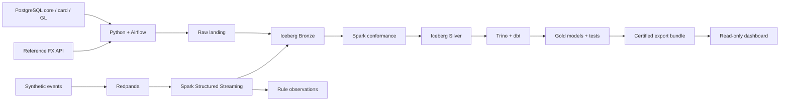

# Digital Banking Open Lakehouse

A banking data pipeline built to keep financial reports correct when a job fails,
events are replayed, or a historical reporting period needs to be rebuilt.

The project brings account, card and general-ledger data into an Iceberg lakehouse,
then publishes a verified reporting bundle. The focus is on recoverable ingestion,
clear data models and reconciliation that can explain where a number came from.
All customers, accounts and transactions are synthetic.

## Architecture



MinIO stores local objects. Iceberg manages table metadata and snapshots; Spark
handles conformance; dbt owns analytical transformations. ADLS and Terraform provide
the cloud storage path, with deployment and identity acceptance documented separately.

## Design decisions

- **Recover before advancing.** A watermark moves only after raw and Bronze writes
  have been verified. A retry recognizes versions already committed.
- **Read a consistent source.** A release captures source tables and control totals
  in one PostgreSQL read transaction, then pins the Iceberg inputs used downstream.
- **Model the financial grain.** Transactions are posting events; transfers have a
  separate fact to count each transfer once. Failed transactions do not move balances.
  Customer SCD2 joins use event time rather than today's customer attributes.
- **Publish after checking.** Silver validation, dbt tests and source/Gold/GL
  reconciliation must pass before a release replaces the current reporting bundle.
  A failed build leaves the previous certified output available.

The [architecture guide](docs/architecture.md), [release contract](docs/releases.md)
and [ADRs](docs/adr/010-full-local-operation.md) explain the implementation and tradeoffs.

## Data products

| Product | What it answers |
| --- | --- |
| Transaction reporting | Activity by date, channel, status, type, branch and historical customer segment |
| Daily account balances | Opening balance + credits − debits = closing balance, including inactive days |
| Customer 360 | Account/card holdings, balance and a defined 30-day activity window |
| Branch and card reporting | Successful card spend and failures without duplicating balance effects |
| Reconciliation | Agreement between source, Bronze, Gold and per-posting ledger entries |
| Rule monitoring | High-value transactions, transfer velocity and repeated failures |

Gold contains **7 dimensions, 4 facts and 4 marts**. Monetary values use exact
Decimal/NUMERIC types and retain their currency. Balances are measured at a date,
not added across dates. LIVE FX is reference data; it does not silently convert Gold.

## Run locally

Use Python 3.11+, Docker with Linux containers, and network access for dependencies.
Allow roughly 16 GB of Docker memory for concurrent operation. Smaller hosts can
run the acceptance checks in stages, as documented in the full operation guide.

```sh
python -m venv .venv
# Activate: .venv\Scripts\Activate.ps1 on Windows, or source .venv/bin/activate on Linux/macOS.
python -m pip install -r requirements-test.txt
python -m scripts.platform up --internal --all --seed
```

`--seed` explicitly prepares the selected demo database with synthetic data. Omit it
to preserve an existing source. The command creates `.env` only when it is missing,
builds a certified release, then starts BI, monitoring, Airflow and the event branch.
Use a separate `--project` and `--runtime` for another demo environment.

| Service | Local address |
| --- | --- |
| Dashboard | http://127.0.0.1:8090 |
| Operational status | http://127.0.0.1:9091/status |
| Prometheus metrics | http://127.0.0.1:9091/metrics |
| Airflow | http://127.0.0.1:8081 |

Airflow credentials are in the generated local `.env`. New schedules stay paused;
add `--enable-schedules` to `up --all` when daily release and FX execution are wanted.
If ports are occupied, use the alternatives in [full-platform.md](docs/full-platform.md).

```sh
python -m scripts.platform status --internal
python -m scripts.platform stop --internal
```

Stopping preserves volumes, releases and checkpoints. The dashboard reads certified
exports only; its four pages cover overview, Customer 360, transactions and reconciliation.

## Verification

```sh
python -m unittest discover -s tests -v
ruff check .
```

The recorded Windows run discovers **96 tests: 91 pass and 5 skip**. The four
infrastructure tests pass separately against PostgreSQL/MinIO/REST and Spark;
the symlink test unavailable on Windows passes on Linux. These scopes are kept
separate from the local test result.

The real Docker acceptance produced the following January 31, 2026 fixture:

| Result | Value |
| --- | ---: |
| Core transaction events | 225 |
| Customer 360 rows | 20 |
| Daily balance rows | 620 |
| Passing reconciliation groups | 30 |
| Certified CSV exports with hashes | 15 |

Trino/dbt completes **15 models and 33 tests**. Acceptance also covers release retry,
historical publication protection, rejection of a failed dbt artifact, live FX replay,
Airflow DAG execution, streaming replay with the same checkpoint, and verified bundle
backup/restore. In the streaming run, two deliveries of 230 messages retain 225 unique
events and 228 Bronze versions; the additional versions come from source-update tests.

[Validation records](docs/validation/full-platform-2026-11-15.json) ·
[Test boundaries](docs/testing.md) ·
[GitHub Actions](https://github.com/longieoo/digital-banking-open-lakehouse/actions)

## Operations and project layout

The [operation guide](docs/full-platform.md) includes live FX ingestion, HTTP readiness,
backup/restore, retention inventory and complete source packaging. Restoring a bundle
does not publish it automatically. The retention planner never deletes Iceberg history.

- `bank/`, `sources/`, `config/`: source contracts, ingestion, releases and serving.
- `processing/`, `streaming/`: Spark conformance and the Redpanda consumer/producer.
- `dbt/`: dimensions, facts, marts and data tests.
- `orchestration/`, `docker/`, `query/`: Airflow, service images and Trino configuration.
- `infra/terraform/`: Azure storage, RBAC and Key Vault definitions.
- `tests/`, `benchmarks/`, `monitoring/`: verification and performance/operations tools.
- `bi/`, `docs/`: dashboard guidance, Power BI measures and technical documentation.

## Scope and next work

This is a working educational platform, not a production banking deployment.
Current limits include single-host coordination, full Silver/Gold rebuilds, retained
stream-history scans and simplified accounting assumptions. General CDC/deletes,
incremental correction handling and distributed HA need further design and evidence.

Azure deployment and ADLS identity checks require configured infrastructure;
Terraform validation alone does not prove them. A runnable web dashboard is included,
while native Power BI execution and full infrastructure disaster recovery remain
separate acceptance gates. See [limitations](docs/limitations.md) and
[Azure acceptance](docs/azure-acceptance.md) for the exact boundaries.
