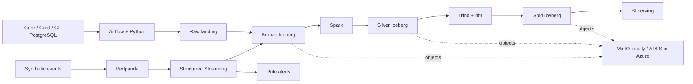

# Digital Banking Open Lakehouse Platform

A **production-style educational banking data platform** built around recoverable ingestion and explainable financial data products. All customers, accounts, cards and transactions are synthetic. This is a portfolio project, not a production banking system.

The central question: **can a pipeline fail, retry and backfill without losing or double-counting financial events—and can we prove agreement with the ledger?**

## Validation at a glance

- **PASS:** source invariants; ingestion recovery/backfill; real local Iceberg snapshots, time travel, schema evolution and reopen; actual Gold SQL business tests; reconciliation mismatch detection; dbt parsing; lint; Terraform init/fmt/validate.
- **UNAVAILABLE:** authoring-machine Docker/Java; deployed PostgreSQL/MinIO/REST/Spark/Trino/Airflow/Redpanda acceptance; Azure deployment; Power BI Desktop.
- **Explicit substitute:** Gold tests run the actual dbt SQL through DuckDB translation against typed fixture Silver. This is not distributed E2E. The public FX endpoint returned HTTP 403; its fixture is labeled.

See the [validation ledger](docs/implementation-plan.md), [test boundaries](docs/testing.md) and [known limitations](docs/limitations.md). Code existence is not runtime validation.

## Architecture



| Technology | Distinct responsibility |
|---|---|
| PostgreSQL | Operational keys, FKs, constraints and exact NUMERIC money |
| Python | Generation, extraction, validation and durable control state |
| Airflow | Scheduling, retry, backfill and Dataset dependencies |
| MinIO / ADLS | Environment-specific object storage |
| Iceberg v2 / REST | Atomic table state, schemas, snapshots and metadata |
| Spark / PySpark | Bronze-to-Silver typing, references, dedup and quarantine |
| Trino | Interactive SQL over the same Iceberg files |
| dbt | Silver-to-Gold dimensions, facts, marts and SQL assertions |
| Redpanda / Structured Streaming | Replayable events, shared conformance and rule monitoring |
| Terraform | Azure storage, RBAC, restricted networking and Key Vault |
| Docker / GitHub Actions | Service profiles and validation automation |
| Power BI | Analytical consumption specification; no fabricated PBIX |

[Full architecture and grains](docs/architecture.md) · [Architectural decisions](docs/adr/001-boundaries.md)

## Business capabilities

| Product | Behavior |
|---|---|
| Customer 360 | Account/card counts, balance, 30-day activity, spend and failure metrics |
| Transactions | Date, status, channel, type, branch and historical customer segment |
| Daily balances | Dense account/date snapshots: opening + credit − debit = closing |
| Branch/card analytics | Purchase value and failures without doubling core balance effects |
| Reconciliation | Source/Bronze/Gold counts, monetary totals and per-posting Core/GL agreement |
| Rule monitoring | High amount, transfer velocity and repeated failures; no ML |

Customer SCD2 tracks segment/branch/status with half-open intervals. Transfers have two core legs but one transfer fact. Reversals are opposite postings linked to originals. Failed events do not affect balances. The demo uses USD, zero opening balances and exact decimal amounts. [Source semantics](docs/source-model.md) · [Gold SQL](dbt/models)

## Local correctness demo

```sh
python -m venv .venv
# Activate the environment, then:
python -m pip install -r requirements-test.txt
python -m unittest discover -s tests -v
python -m scripts.local_demo
```

The measured small demo produces 113 source/real-Iceberg/Gold events, eight Customer 360 rows, 248 daily balances and zero reconciliation failures. Its typed Silver substitute is prominently labeled. Runtime files stay under ignored runtime/.

## Distributed platform

Requires Docker Compose v2, Linux containers, image/Maven access and approximately 16 GB available RAM for a staged demo. Start named services as needed.

```sh
python scripts/create_demo_env.py
# Also creates a writable runtime directory for the container demo.
docker compose --profile core --profile lakehouse up -d --wait postgres catalog
docker compose build bank spark dbt
docker compose run --rm bank seed --profile small
docker compose run --rm --entrypoint python bank -m bank.pipeline
docker compose --profile processing run --rm spark
docker compose --profile query up -d --wait trino
docker compose run --rm dbt build --profiles-dir .
```

The [full runbook](docs/demo.md) covers clean clone, profiles, failure/retry, backfill, snapshots, streaming and Airflow. `python scripts/e2e.py` is the opt-in real-stack acceptance gate; it could not run in authoring.

## Reliability and quality

The cursor is `(updated_at, transaction_id)`. Required order: extract → immutable raw write/read-back → Bronze commit/read-back → completed manifest and atomic forward-watermark update. Immutable source-version identities make reruns safe. Backfills leave forward state unchanged. Tests inject failures before and after target commit.

Bad types, references, currency, amount or reversal links go to quarantine. dbt checks grains, SCD intervals, card/core agreement, transfer legs, balance continuity and reconciliation. Even a balanced but misallocated journal produces FAIL. [Recovery design](docs/adr/002-ingestion-state.md) · [Reconciliation](docs/reconciliation.md)

## Storage, Spark and performance

Raw retains canonical batches; Bronze is source-aligned Iceberg; Silver is typed/conformed; Gold contains dimensional products. Iceberg uses compressed Parquet, daily transaction partitions, snapshots and MERGE. It supplies table-state management, not universal speed improvements.

[Measured local Iceberg/Parquet results](docs/performance/iceberg-vs-unmanaged-parquet.md) are small single-process samples. [Spark/JDBC experiments](docs/performance/spark.md) cover volumes, partitions and join hints but remain unmeasured without that runtime. Full Silver/Gold scans and stream-history recomputation are deliberate scale limitations.

## Security, cloud and operations

Gold excludes direct PII and provides masked labels. PostgreSQL masked views/roles and Trino Gold-only analyst rules demonstrate least privilege. Local Trino HTTP usernames are unauthenticated: shared use requires TLS and identity enforcement. Secrets remain in ignored .env or external storage.

Terraform provisions ADLS Gen2 and Key Vault with RBAC/restricted access; MinIO remains the local alternative. Cloud REST hosting and identity validation remain prerequisites. No paid resources or always-on compute were deployed. [Azure](docs/azure.md) · [Cost and teardown](docs/cloud-cost.md) · [Security](docs/security.md)

CI checks lint, contracts, local Iceberg, SQL, dbt parsing, Compose and Terraform. Manifests, JSON metrics and monitoring SQL expose failures, retries, counts and freshness. [Observability](docs/observability.md)

## Portfolio navigation

- [Architecture and dimensional model](docs/architecture.md)
- [Implementation and validation ledger](docs/implementation-plan.md)
- [Streaming guarantees and limits](docs/streaming.md)
- [Airflow and metadata runner](docs/orchestration.md)
- [Power BI model, four-page specification and DAX](bi/README.md)
- [25 interview-defense topics](docs/interview-defense.md)
- [Coursework reuse](docs/coursework/README.md)
- [Known limitations and next gates](docs/limitations.md)

Repository modules: bank/ and sources/ for source/ingestion contracts; processing/ for Spark; dbt/ for Gold; streaming/, orchestration/, query/, infra/terraform/, tests/, benchmarks/, monitoring/, bi/ and docs/. No runtime data or Terraform state belongs in Git.

Next priorities are real Docker acceptance, measured Spark tuning, cloud identity validation and a genuine BI dashboard—not more technologies.
