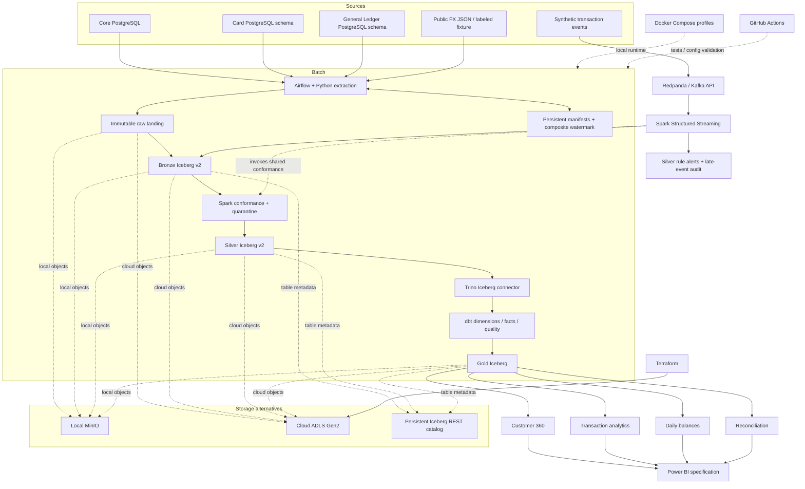
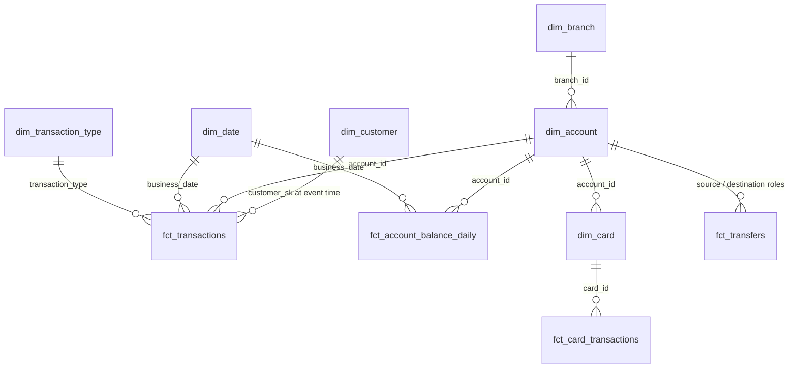

# Implemented architecture

The stream deliberately adds a Bronze version merge before invoking the common
Silver code. This shares deduplication/reversal semantics with batch. The FX fixture
has its own explicit ingestion entry point and is not automatically fetched by the
scheduled core DAG. BI is a serving specification, not a generated PBIX.

## Table model

| Layer | Grain / purpose | Persistence |
|---|---|---|
| Raw | Canonical source batch, content hash | Immutable local/object file |
| Bronze | Business key + source_updated_at | Iceberg history of observed versions |
| Silver transactions | Latest valid transaction event | Typed Iceberg MERGE |
| Silver customer_history | Customer + updated_at | Preserved history |
| dim_customer | Contiguous segment/branch/status interval | Deterministic SCD2 |
| fct_transactions | One core posting/event, including failed events | Gold Iceberg |
| fct_transfers | One transfer, independent of its two posting legs | Gold Iceberg |
| fct_card_transactions | One card purchase | Gold Iceberg |
| fct_account_balance_daily | Account/date including no-activity dates | Gold Iceberg |
| mart_customer_360 | One customer, explicit date/reporting currency | Gold Iceberg |
| mart_reconciliation_daily | Date/currency, three agreement levels | Gold Iceberg |

Atomicity is per Iceberg table and local control transaction. No cross-table or
cross-engine atomic snapshot is claimed. See ADRs for boundaries and consequences.
